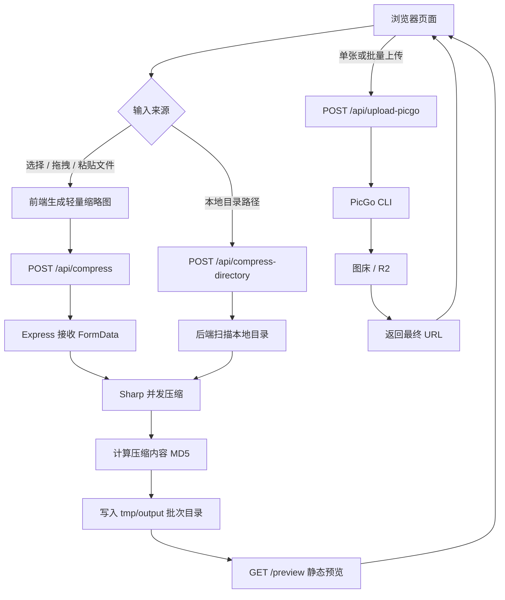
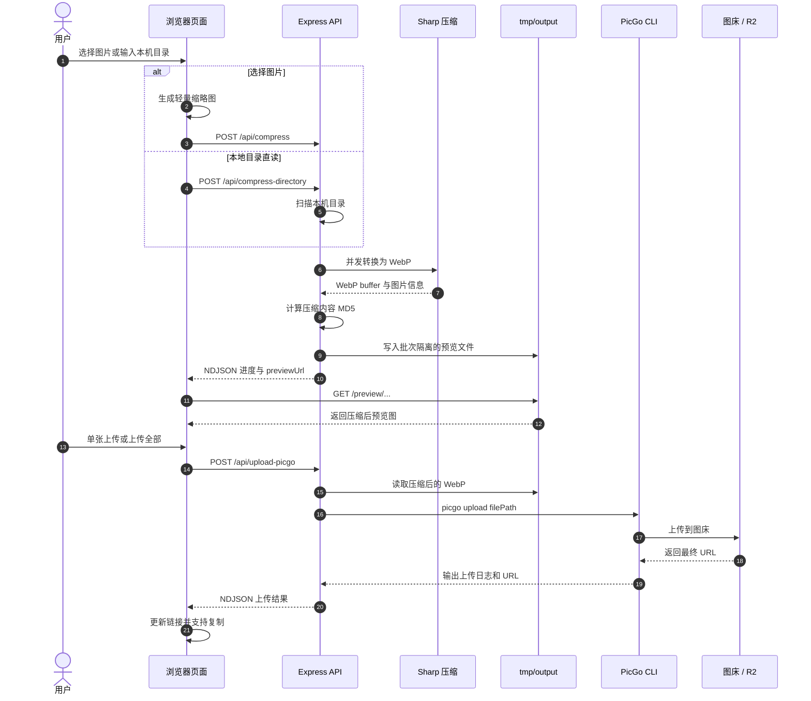

# PicGo WebP Uploader

一个本地运行的图片压缩、预览与 PicGo 上传工具。项目使用 Node.js、Express、Sharp 和 PicGo CLI，将图片批量转换为 WebP，并在确认压缩结果后上传到已配置的图床。

## 功能概览

- **两阶段处理流程**：先压缩并预览，再选择单张上传或批量上传。
- **WebP 压缩参数**：支持质量、effort、最大宽度和压缩并发配置。
- **大文件选择优化**：大批量选择时先生成轻量缩略图，避免直接在页面中解码大体积原图。
- **本地目录直读**：可输入本机目录路径，由后端直接扫描磁盘并压缩，避免浏览器传输和缓存整批原图。
- **批量上传队列**：上传阶段使用可配置并发，避免一次性启动过多 PicGo 进程。
- **链接复制**：支持 Markdown、URL、BBCode 和 HTML `` 格式；压缩后可复制本地预览链接，上传后自动切换为图床 URL。
- **临时文件隔离**：压缩产物写入独立批次目录，避免重复图片或不同压缩参数互相覆盖。

## 架构与数据流



## 处理时序



### 路径说明

压缩预览文件会写入本地临时目录：

```text
tmp/output/{batchId}/{yyyy}/{mm}/{dd}/{index}-{md5}.webp
```

其中 `batchId` 只用于本地临时文件隔离和预览缓存隔离，不参与最终图床 URL 的生成。最终 URL 由 PicGo 及其上传插件配置决定。

## 安装与启动

### 环境要求

- Node.js 18 或更高版本
- 已安装并配置可用的 PicGo CLI

### 安装依赖

```powershell
cd D:\Code\Other\picgo-webp-uploader
npm install
```

### 启动服务

```powershell
npm start
```

默认访问地址：

```text
http://localhost:5177
```

如果端口 `5177` 已被占用，可以临时指定其他端口：

```powershell
$env:PORT=5178; npm start
```

## 配置项

### 环境变量

| 变量 | 默认值 | 说明 |
| --- | --- | --- |
| `PORT` | `5177` | Web 服务端口 |
| `PICGO_PATH` | `C:\nvm4w\nodejs\picgo.cmd` | PicGo CLI 可执行文件路径 |
| `OUTPUT_DIR` | `tmp/output` | 压缩预览文件输出目录 |

示例：

```powershell
$env:PICGO_PATH="D:\your\path\to\picgo.cmd"
$env:OUTPUT_DIR="D:\temp\picgo-webp-output"
npm start
```

### 前端控制项

| 控制项 | 默认值 | 说明 |
| --- | --- | --- |
| WebP 质量 | `82` | Sharp WebP quality，`100` 表示最高质量，不等同于 lossless |
| 压缩 effort | `6` | Sharp WebP effort，数值越高通常越慢、压缩更充分 |
| 压缩并发 | `8` | 后端 Sharp 并发任务数；前端可选到 `24`，服务端最多接受 `64` |
| 请求分批 | 不分批 | 仅在浏览器内存紧张时手动启用 |
| 最大宽度 | `0` | `0` 表示不限制；大于 `0` 时按宽度等比缩小且不放大 |
| 上传并发 | `5` | 批量上传 PicGo 进程并发数；前端可选到 `10` |

## 使用流程

### 选择文件模式

1. 通过点击、拖拽或粘贴选择图片。
2. 页面为大批量文件生成轻量缩略图，避免直接显示原图造成卡顿。
3. 调整压缩参数。
4. 点击“压缩并预览”。
5. 检查压缩后大小、尺寸和预览图。
6. 单张上传或点击“上传全部就绪图片”。
7. 使用“复制全部”导出链接。

### 本地目录模式

适合处理较大的相册目录，例如：

```text
D:\Code\Blog\MyBlog\public\images\albums\AcgExample
```

使用方式：

1. 在“本机目录路径”输入框中填入目录。
2. 点击“压缩本地目录”。
3. 后端直接读取本机磁盘文件并压缩。
4. 预览、上传和复制链接流程与选择文件模式一致。

该模式不会把原图批量加载到浏览器内存中，更适合上百 MB 的图片目录。

## API 说明

| 接口 | 方法 | 说明 |
| --- | --- | --- |
| `/api/health` | `GET` | 返回服务状态和 PicGo 路径 |
| `/api/compress` | `POST` | 接收 `multipart/form-data` 图片并压缩，返回 NDJSON 事件流 |
| `/api/compress-directory` | `POST` | 接收本机目录路径，后端扫描并压缩，返回 NDJSON 事件流 |
| `/api/upload-picgo` | `POST` | 根据压缩结果 `fileId` 调用 PicGo 上传 |
| `/api/cleanup` | `POST` | 清理压缩预览输出目录 |

## 运行时行为

- 服务启动时会清理上一次残留的输入临时文件和预览输出文件。
- 点击“清空”会调用 `/api/cleanup` 清理预览产物。
- 单张上传成功后会删除对应的本地压缩文件，并清理空目录。
- 压缩文件名使用压缩内容 MD5，确保同一内容生成稳定标识。
- 上传返回 URL 来自 PicGo 输出日志，最终对象 key 由 PicGo 上传插件配置决定。

## 注意事项

- 本工具面向本机使用，不建议直接暴露到公网。
- 本地目录直读接口可以访问运行该 Node 进程的文件系统，请只在可信环境中使用。
- GIF 动图不会作为动图处理；当前压缩流程面向静态图片。
- WebP `quality: 100` 不是无损 WebP。如需真正 lossless，需要在代码中启用 Sharp 的 `lossless: true`。
- Windows 下执行 `.cmd` 格式的 PicGo CLI 时，服务端已对 `spawn` 启用 `shell: true`。
